<p align="center">
  
</p>

<h1 align="center">Sheaf</h1>

<p align="center">Sort a window's tabs into native tab groups with the model you choose, then review, apply, and undo.</p>

<p align="center">
  <picture><source media="(prefers-color-scheme: dark)" srcset="assets/screenshots/review-dark.png">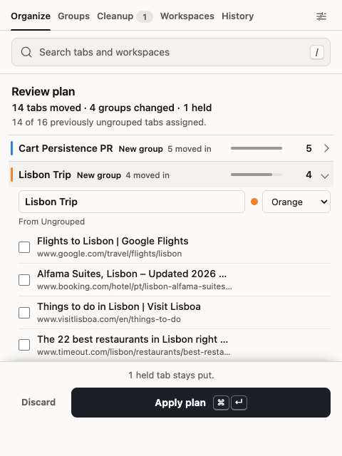</picture>
  <picture><source media="(prefers-color-scheme: dark)" srcset="assets/screenshots/organized-dark.png">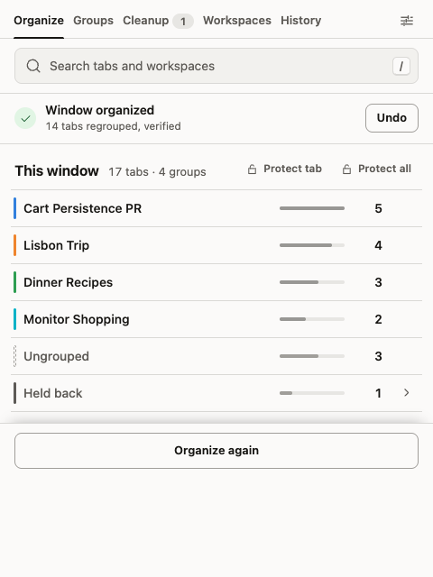</picture>
</p>

Sheaf is a Manifest V3 extension for Chromium browsers that sorts the tabs in a window into native tab groups. You bring an OpenAI-compatible model, and the extension decides what it's allowed to see. Changes to the browser are treated with care: the window is checked again just before anything moves, every step is journaled, the result is verified, and the last organization can be undone.

## Features

- **Organize** the window, selected tabs, or one group into native tab groups with the model you choose. Review the plan first or let it apply, and undo either way.
- **Learn from corrections** you make during review, and keep your own grouping instructions and group names.
- **Protect** tabs and groups from organizing until restart or permanently. Pinned, incognito, and browser pages are always left alone.
- **Clean up** duplicates and stale tabs. Nothing closes until you confirm.
- **Auto-file** new tabs into the groups you already have (optional, off by default), each filing with Undo.
- **Search** open tabs and workspaces by title, address, or meaning, from the popup or a finder over any page.
- **Save workspaces** of windows, groups, or tabs, and reopen them as linked windows with versions and a trash.
- **Track usage**: history, diagnostics, and per-provider token counts and cost, without storing tab titles or URLs.
- **Back up** settings, never including API keys.

<details>
<summary>Feature details</summary>

**Organizing.** Organize the current window, the selected tabs, one existing group, only ungrouped tabs, or everything except chosen groups. The request runs in the background service worker, so closing the popup doesn't cancel it. By default a plan is applied as soon as it passes final checks. Turn on review if you'd rather rename groups, change colors, or move tabs first, with a before-and-after view of new, renamed, merged, and split groups. If the tabs change while a plan is pending, it has to be regenerated instead of applied to a window it no longer matches. A failed apply is rolled back, and **Undo** restores the previous arrangement for the rest of the session without overwriting anything you changed since.

**Learning from corrections.** When you rename or move something during review, you can keep that correction as a rule for future runs. Custom grouping instructions and preferred group names are also editable in settings.

**Protection.** Hold tabs or groups out of organizing until the browser restarts, from the popup, the tab context menu, or a keyboard shortcut. Permanent rules can protect locations or group names. Pinned, incognito, split-view, browser-internal, and unreadable tabs are always left in place, and the popup tells you why each one was held.

**Cleanup.** After organizing, the extension can suggest exact duplicates, tabs left inactive for a while (24 hours by default), and inactive tabs the model marks as likely clutter (after 6 hours). Nothing closes unless you select it and confirm. Active, pinned, audible, protected, and split-view tabs are never suggested. Optionally, groups the extension created can be ungrouped automatically after a set number of days.

**Groups.** The Groups view lists your tab groups, filters them, and previews edits before applying them to the real groups.

**Auto-filing.** Optional, and off by default. When a tab opens or navigates, the extension can file it into one of the groups you already have, using a decision model you choose: one that returns a probability for each group instead of writing text. A tab moves only when the model is confident and clearly prefers one group; anything borderline stays where it is and isn't asked about again until it goes to another site. Filing never creates, renames, or closes a group. Protected, shared, and opted-out groups ("Don't auto-file into this group" in the Groups view) are never a target, and their tabs never move. Every filing is listed under **History → Auto-filed** with **Undo** and **Don't file this site here**, and a tab you undo or move yourself is left alone for the rest of the session. Re-filing grouped tabs that move to another site and filing into other windows are separate settings, both off. When enough tabs fit no group, the extension suggests organizing them (or, if you choose, starts organizing them), which goes through the normal organize flow and its Undo.

**Search.** Press `/` in the popup to search open tabs and saved workspaces by title and address. Results you pick are remembered for that query until the browser closes, and that memory never leaves the browser. Semantic search, which finds related tabs by meaning, is optional and uses a separate embedding provider. The same search is available anywhere in the browser through the finder shortcut (see [Install](#install)).

**Workspaces.** Save a window, some groups, or selected tabs as a workspace that keeps tab order and groups. Open a workspace in its own window and it stays linked: changes are saved when the window closes, earlier versions are kept, and you can restore any of them. Deleted workspaces go to a trash for 7 days. Unused workspaces can also be moved there automatically.

**History and diagnostics.** History keeps counts only (tabs grouped, moved, ungrouped, and reordered per run) plus reasoning level, time to first token, token usage, and output speed. When auto-filing is on, an **Auto-filed** tab beside the runs lists this session's filings. Diagnostics logs provider runs and recovery events with latency, usage, and an optional cost estimate. Neither stores tab titles, URLs, or group names.

**Usage.** **Settings → Usage** counts requests and tokens for the organizer model, the decision model, and embeddings, today, over 7 or 30 days, or all time. Cost uses the price the provider reports where it does (OpenRouter, for example), or your own per-million-token rates otherwise, and is broken down into what organizing costs per 1,000 runs and what search and auto-filing cost per year at your recent pace. Only counts are kept, in local storage, with daily detail for the last 30 days.

**Backup.** Settings can be exported and imported, including auto-filing settings and calibrations. Backups never include API keys, custom header values, or extra request bodies, and a restored backup leaves auto-filing off until you turn it on again.

</details>

## Install

Requirements: a Chromium browser version 140 or later.

**From a release.** Download `sheaf-<version>.zip` from the [GitHub releases](../../releases) and unzip it. Every release is built from its tagged commit by GitHub Actions.

**From source.** With Node.js 22.6 or newer and npm:

```sh
npm install
npm run build
```

1. Open the browser's extensions page and turn on **Developer mode**.
2. Choose **Load unpacked** and select the unzipped release folder, or `dist/` if you built from source.
3. A setup page opens on install (or choose **Set up Sheaf** in the popup). Paste the API URL of any OpenAI Chat Completions-compatible service, hosted or local (a base URL like `https://api.openai.com/v1` is enough; the **API route** beside it, `/chat/completions` by default, can be changed or cleared), plus a model name and key.
4. Choose **Save and verify** and approve the host permission, then choose what's sent and whether plans apply without review.

Two shortcuts are suggested by default (Option+Shift on macOS). **Alt+Shift+O** starts organizing the current window and pops up a small organizer window over the browser that follows the run to its review or result. Approving a plan there closes the window; the changes are applied in the background and the result arrives as a notification with Undo. If you dismiss it mid-run, the toolbar badge shows the run is still going and a notification reports the outcome. **Alt+Shift+F** opens a Spotlight-style finder over the browser. Type to match open and saved tabs; when search by meaning is set up, related tabs follow the direct matches. Use the arrow keys and Enter to switch, and press Escape or click away to dismiss it. The other commands (open the popup, organize selected tabs, protect selected tabs, undo the last organization, undo the last auto-filing, save and close a linked workspace window) have no default keys. You can assign or change any of them on the browser's extension shortcuts page.

## Screenshots

| Search by meaning | Cleanup suggestions | Groups |
|---|---|---|
| <picture><source media="(prefers-color-scheme: dark)" srcset="assets/screenshots/search-dark.png">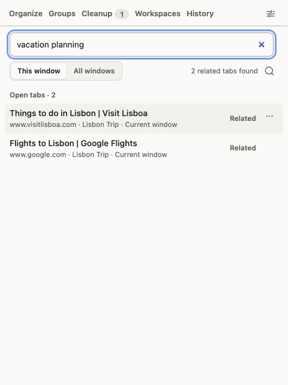</picture> | <picture><source media="(prefers-color-scheme: dark)" srcset="assets/screenshots/cleanup-dark.png">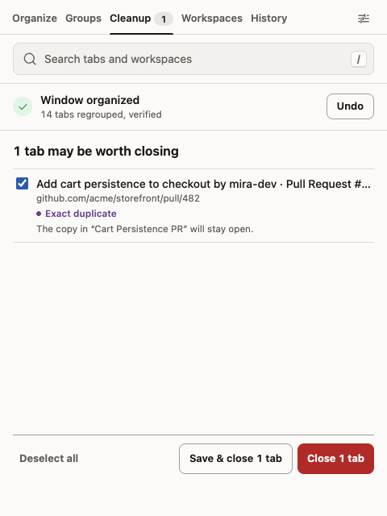</picture> | <picture><source media="(prefers-color-scheme: dark)" srcset="assets/screenshots/groups-dark.png">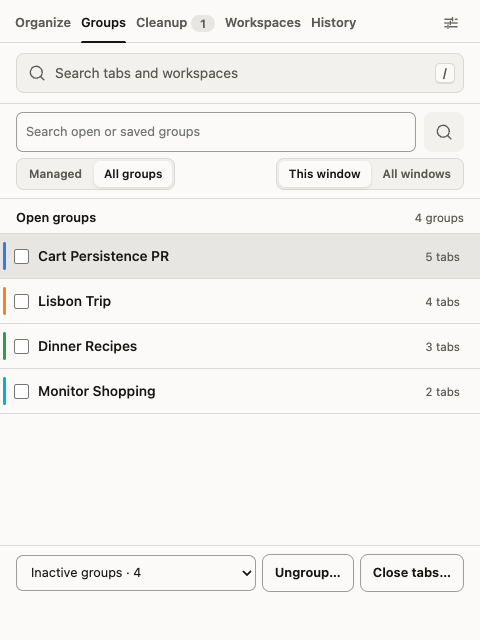</picture> |

| Held tabs | Workspaces | History |
|---|---|---|
| <picture><source media="(prefers-color-scheme: dark)" srcset="assets/screenshots/protection-dark.png">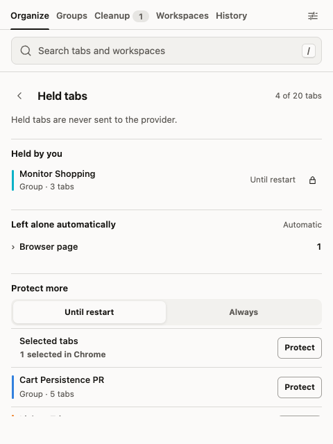</picture> | <picture><source media="(prefers-color-scheme: dark)" srcset="assets/screenshots/workspaces-dark.png">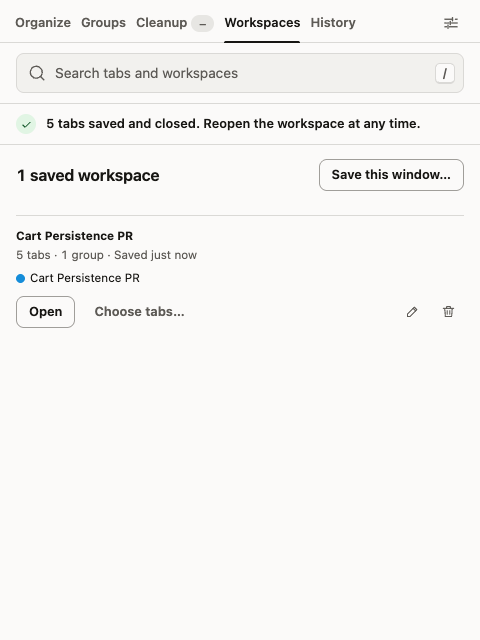</picture> | <picture><source media="(prefers-color-scheme: dark)" srcset="assets/screenshots/history-dark.png">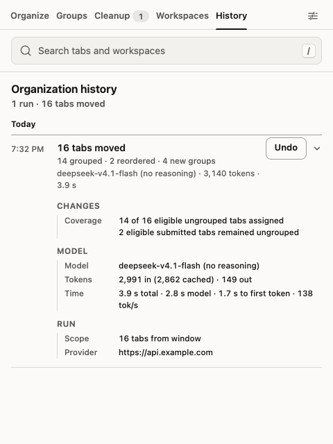</picture> |

Auto-filing places new tabs into the groups you already have, and each filing can be undone:

<p>
  <picture><source media="(prefers-color-scheme: dark)" srcset="assets/screenshots/auto-filed-dark.png">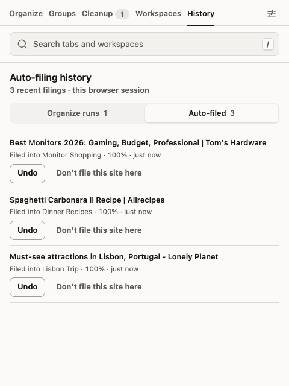</picture>
  <picture><source media="(prefers-color-scheme: dark)" srcset="assets/screenshots/auto-filing-settings-dark.png">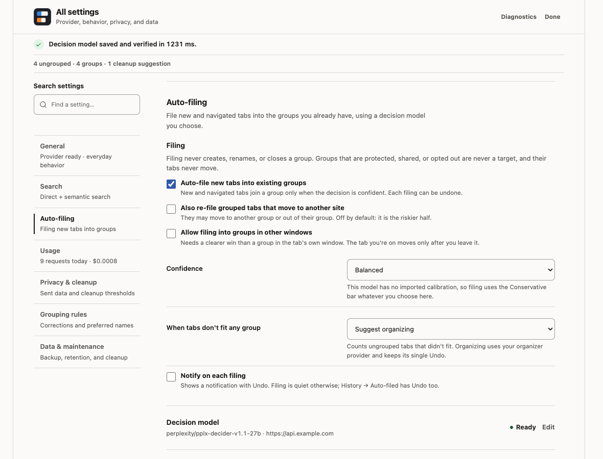</picture>
</p>

The finder, opened with **Alt+Shift+F** over any page:

<picture><source media="(prefers-color-scheme: dark)" srcset="assets/screenshots/finder-dark.png">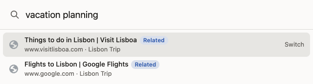</picture>

First-run setup, which opens on install: connect a model with one API URL, choose what's sent, and you're ready:

<picture><source media="(prefers-color-scheme: dark)" srcset="assets/screenshots/setup-dark.png">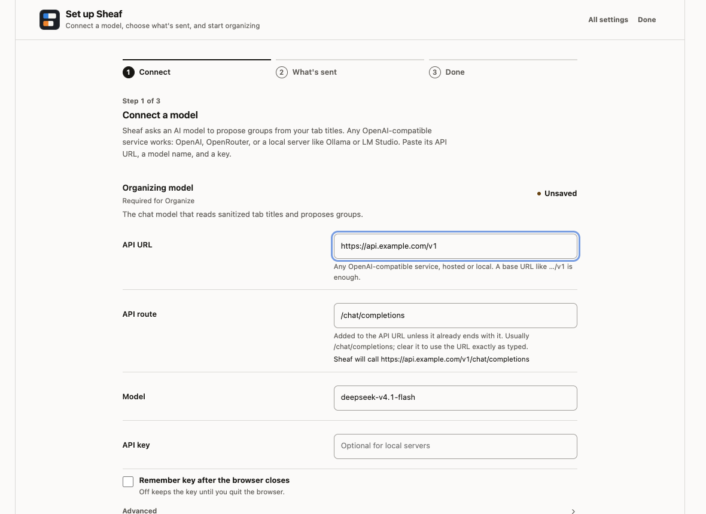</picture>

All settings, in the order you'd set things up: Connections, Organize, Privacy, Search, Auto-filing, Cleanup, Shortcuts, Usage, and Data:

<picture><source media="(prefers-color-scheme: dark)" srcset="assets/screenshots/settings-dark.png">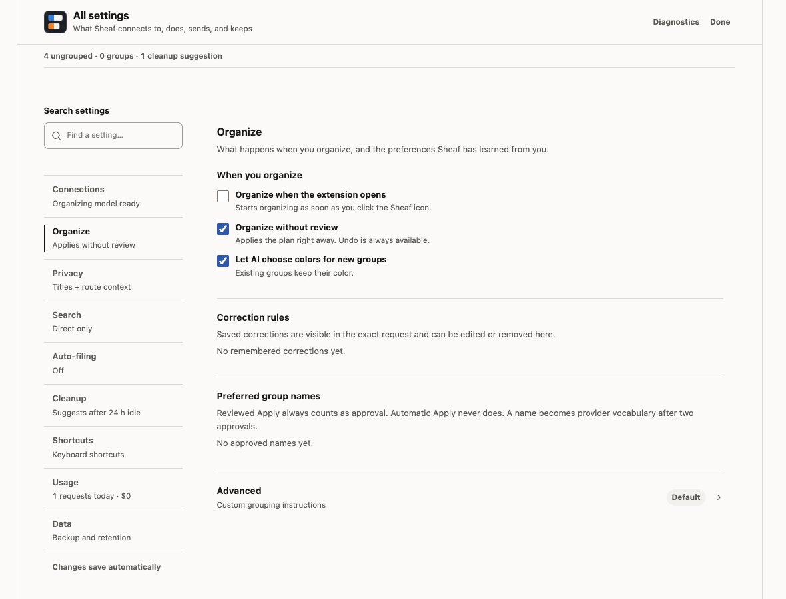</picture>

**Settings → Usage**, with requests, tokens, and cost per provider and per feature:

<picture><source media="(prefers-color-scheme: dark)" srcset="assets/screenshots/usage-dark.png">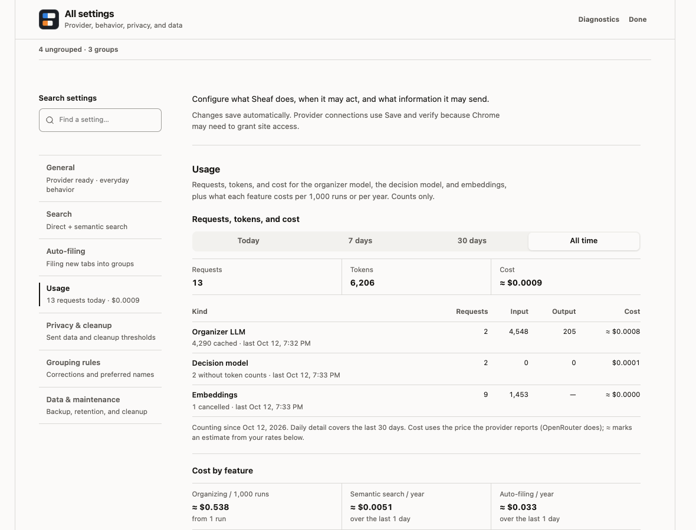</picture>

## Privacy

The full policy, including what's stored on the device, is in [PRIVACY.md](PRIVACY.md).

Only sanitized tab metadata goes to the provider: a cleaned title, the site, and, depending on the detail level, the hostname and a sanitized path. Query strings, fragments, credentials, page content, favicons, cookies, and history are never sent. Tabs get temporary numeric IDs instead of browser tab IDs, and local file paths never leave the device. Identifiers that look like tokens, UUIDs, emails, or long numbers are redacted everywhere — titles, paths, group names, and your search text. You can open the exact request before it's sent.

What's sent is set under **Settings → Privacy**:

- **Detail level:** titles + domains, titles + route context (the default), or titles + hostnames + full paths (identifiers still redacted).
- **Existing group names**, **localhost and private-network tabs**, and **local file pages** (title and a local-file label only) are included by default, and each can be turned off.
- **Allow and deny lists** limit which domains are eligible.

API keys and custom headers are kept for the browser session only. **Remember key after the browser closes** keeps a key across restarts, but it's stored as plain text in extension storage, so only use it on a device you trust.

### Host permissions

The manifest lists `https://*/*` (plus localhost) as an optional host permission because your provider could be on any HTTPS origin, and Chromium only grants hosts the manifest declares. Nothing is requested at install. When you save a provider, the extension asks for that one host, and every request is checked against the exact configured origin and port. See [`src/provider/request-policy.ts`](src/provider/request-policy.ts). A provider origin may be a private-network host over HTTPS (a model on your LAN, say) or localhost over HTTP; plain HTTP to anything other than loopback is refused.

### Auto-filing data

The decision model is a third provider, configured separately: any server that speaks the decision API (`{ model, state, questions }`, answered with a probability per option), or any OpenAI-compatible chat model, which is asked with one-letter labels and read through logprobs. It's set up in **Settings → Connections** as the **Filing model**, and can reuse the organizing model's connection with a different model name. Its host permission, session-only key, and custom headers work like the other providers', and a localhost server needs no new permission.

It receives the same sanitized tab metadata as the organizer, at the same detail level, with temporary keys instead of browser IDs: the new tab's title and site, and each eligible group's name (unless existing group names are turned off), sites, and up to five member titles. **Settings → Auto-filing → Advanced → View last decision request** shows the exact last request.

Tab titles are written by the pages themselves, and ordinary-looking text in a title can argue a model into the wrong group. Filing limits what that can do rather than trusting the model: a page can at worst put its own tab in the wrong group or take it out of its group, never touch another tab or group, and every move is listed with Undo. Probabilities from different models aren't comparable, so a model uses the Conservative bar until you import a calibration for it from the filing benchmark. The filing log with tab titles stays in session storage and is forgotten when the browser closes; diagnostics record counts, latency, and confidence buckets only.

### Semantic search data

Semantic search is off until you enable it and configure an embedding provider. It then sends the same sanitized tab metadata to that provider, plus group names (identifiers redacted) unless you turn off **Index group names too**. Your search text goes to the embedding provider to be matched, with identifiers redacted first. **Break near-ties with the organizing model** (under Search → Advanced) is off by default. When on, and the top two results score within 0.02 of each other, it sends your query (also identifier-redacted) and those results' sanitized metadata to the organizer provider and uses the order it returns. Results are shown before that request finishes, and a failed or late answer leaves the order alone.

Embeddings and pending indexing work are stored locally in IndexedDB and kept until you clear the index, including vectors from earlier provider or model settings. A rebuild reuses a cached vector only when both the document and the provider configuration match. The extension requests `unlimitedStorage` so the browser doesn't evict this data. Clearing the index or uninstalling the extension removes it.

## Development

See [CONTRIBUTING.md](CONTRIBUTING.md) for the build and test commands, the smoke tests, the benchmark CLI, and the project layout.

## License

[MIT](LICENSE)
